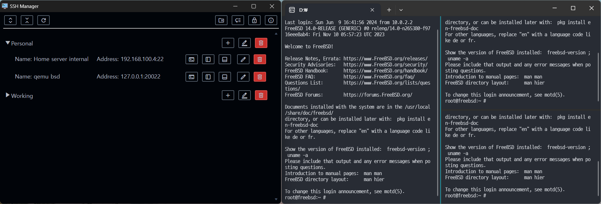

SSH host manager for personal using


## Usage
```sh
./ssh-manager
# or
./ssh-manager &
```

## Requirements
* chrome or chromium or ms-edge
* MS-Windows - Windows Terminal (Download automatically if default installation is not exist)
* Linux / FreeBSD - Tilix (GNOME), or Konsole + `gdbus` (KDE).

## Password asking when executing
* First time - Create `hosts.dat` with the password
* Then - Open `hosts.dat` with the password

Window dimensions and position are saved in `window.json` beside the executable and restored on the next launch.
The toolbar's sun/moon button switches between dark and light themes. The selected theme and connection-group panel side are also saved in `window.json`; existing installations default to dark. The saved theme is applied in the initial HTML before rendering.

## Build
```sh
make
```

## Troubleshooting

If escape codes like `11;rgb:...` appear at the prompt when starting Byobu or logging in with `byobu-enable`, run this once inside Byobu on the remote host:

```sh
tmux set -s escape-time 500
printf '\nset -s escape-time 500\n' >> "${BYOBU_CONFIG_DIR:-$HOME/.byobu}/.tmux.conf"
```
